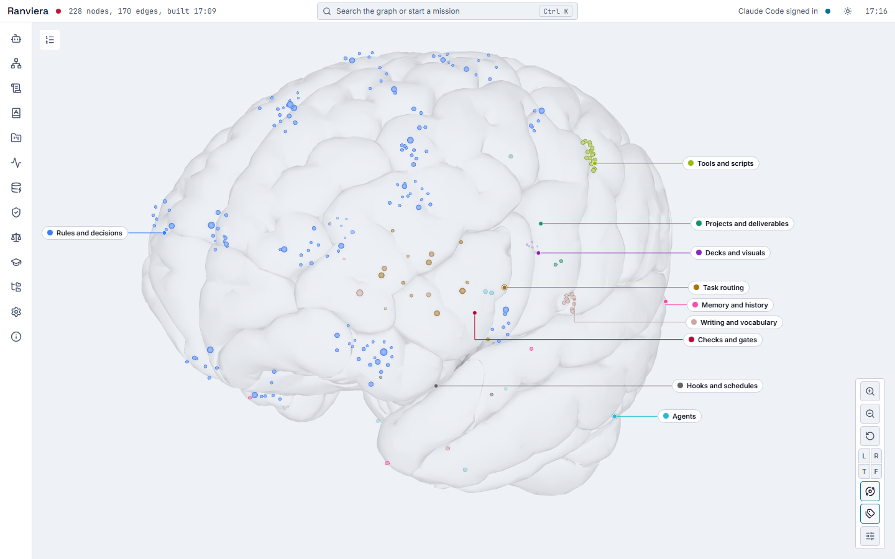
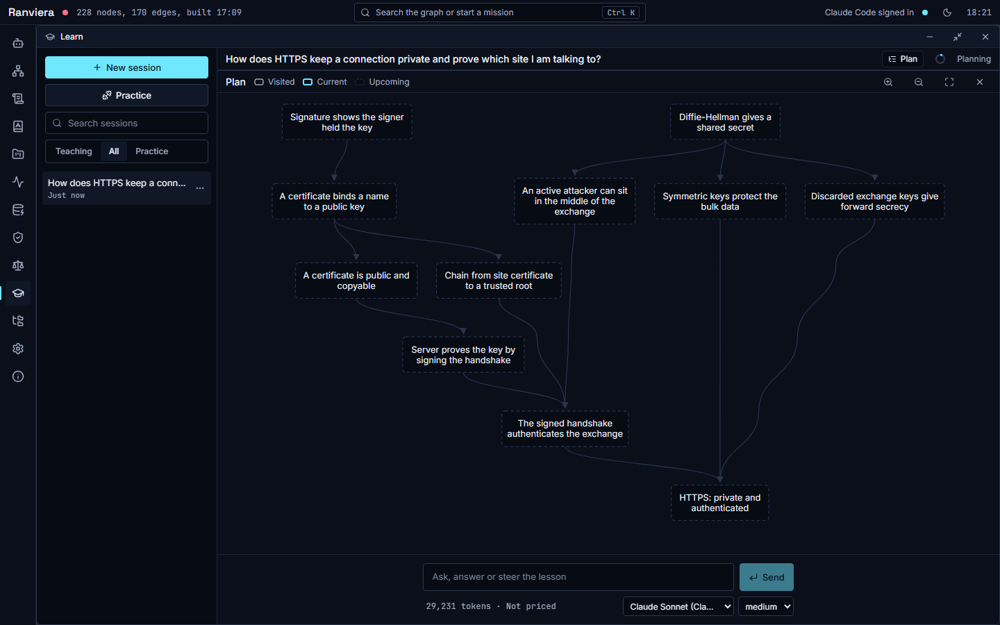
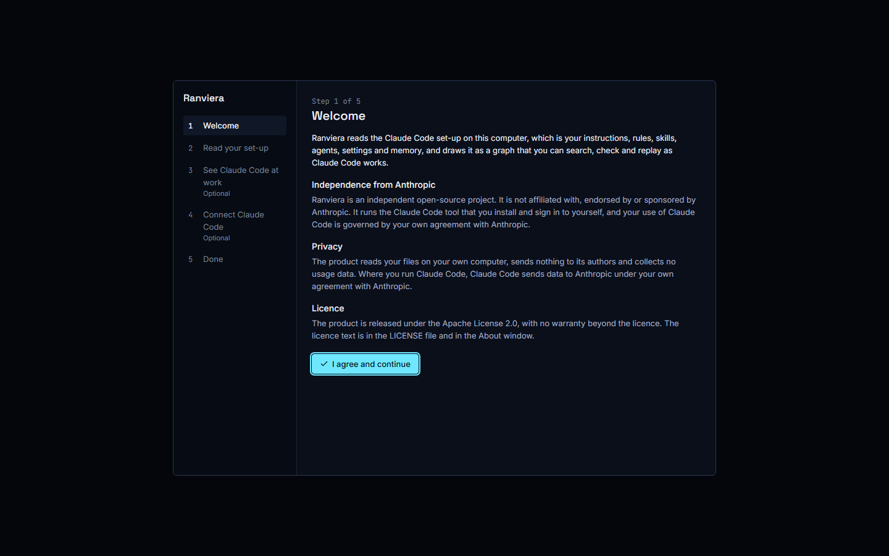
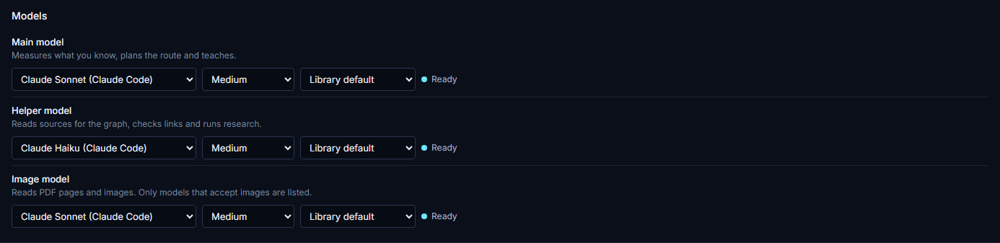
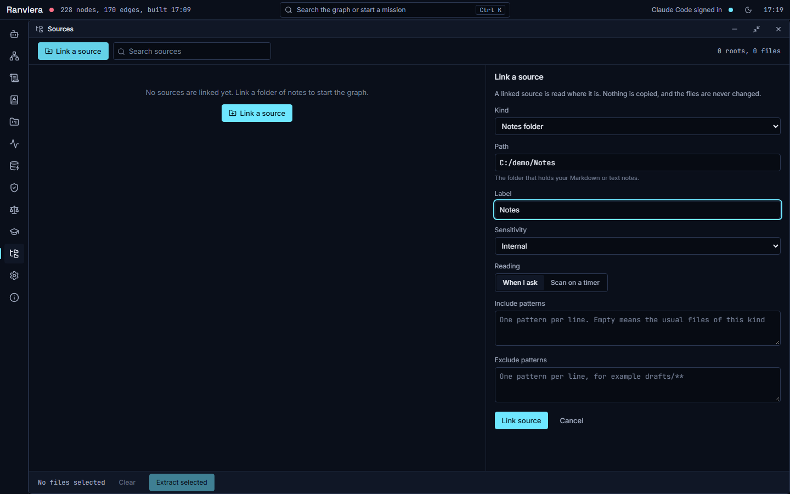
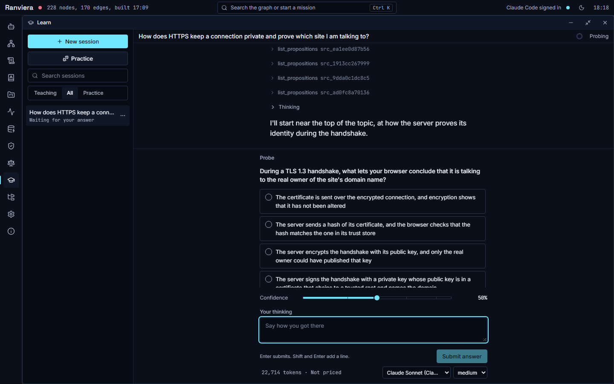
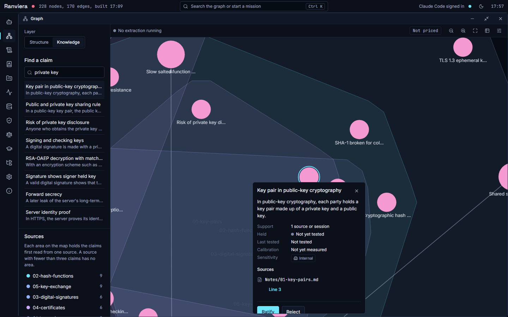

<div align="center" id="hero-image">
  <picture>
    <source srcset="docs/assets/ranviera-brain-dark.png" media="(prefers-color-scheme: dark)">
    
  </picture>
</div>

<h1 align="center">Ranviera</h1>

<p align="center">See your Claude Code set-up as a brain, check it for faults, and learn from your own notes.</p>

<p align="center">
  <a href="https://github.com/JinaJaundice/ranviera/releases">Download</a> |
  <a href="#guides">Guides</a> |
  <a href="LICENSE">Licence</a>
</p>

Ranviera is a desktop app for Windows, macOS and Linux. It reads the Claude Code set-up on your computer, draws it as a knowledge graph in the shape of a brain, and checks it for broken references and conflicting rules. It can also replay what Claude Code does, step by step.

Ranviera also helps you learn. You link your notes, PDFs and other sources, and Ranviera extracts claims from them, each with a link back to the source lines. A teacher then asks what you already know, plans a route and teaches one step at a time. Ranviera is an independent open-source project. It is not affiliated with, endorsed by or sponsored by Anthropic, and it is not affiliated with LearnHarness, whose data format it shares. You install and sign in to Claude Code yourself, and your use of it is governed by your own agreement with Anthropic.

## What you can do

- See the `CLAUDE.md` file, rules, skills, agents, hooks, settings and memory in `~/.claude` as one graph.
- Open the Health window to find cited paths that do not exist, conflicting rules and duplicates.
- Replay what Claude Code did, if you choose to add the optional hooks.
- Link notes, PDFs, Claude memory, Claude Code transcripts and project Markdown, and extract them into claims.
- Learn a topic with a teacher, and answer practice problems in your own words.
- Run lessons on Claude Code, on a provider with an API key, or on a model on your own computer.

## How it works

Ranviera reads your files and gives each rule, skill, agent, memory file and setting a node in the graph. Each node is placed in a region of the brain that matches its job, such as Rules and decisions, Tools and scripts, Memory and history, and Agents. The Health window lists each fault with its file, its line and an Open button.

When you link a source, Ranviera reads it and extracts claims. A claim is one short statement, and it keeps a link to the line of the source it came from, which lets you check it. Claims appear in the Knowledge layer of the Graph window.

When you ask to learn a topic, the teacher first asks questions to see what you already hold. It then plans a route from there to your goal. The map below shows a route of 11 steps. The teacher teaches one step at a time, checks your understanding and sets practice problems.

<p align="center">
  
</p>

## Download and install

Download the file for your system from the [Releases page](https://github.com/JinaJaundice/ranviera/releases). Ranviera has no automatic update. Download a new release when you want one.

| System | File |
|---|---|
| Windows | `Ranviera-Setup-<version>.exe`, an installer for one user that needs no administrator rights |
| macOS, Apple silicon | `Ranviera-<version>-arm64.dmg` |
| macOS, Intel | `Ranviera-<version>-x64.dmg` |
| Linux | `Ranviera-<version>-<arch>.AppImage` |

The first releases are not code-signed. Windows SmartScreen and macOS Gatekeeper may therefore ask you to confirm before the app opens. Verify the download, as described below, before you confirm.

**Windows**

1. Run the `.exe` file. If SmartScreen shows a blue window, choose More info and then Run anyway.
2. Open Ranviera from the Start menu.

**macOS**

1. Open the `.dmg` file and drag Ranviera into Applications.
2. Open Ranviera from Applications. If Gatekeeper blocks it, open System Settings, choose Privacy and Security, and choose Open Anyway.

**Linux**

1. Make the file executable with `chmod +x Ranviera-<version>-<arch>.AppImage`.
2. Run the file.

### Verify a download

Each release carries the file `SHA256SUMS.txt` and a GitHub build attestation for each installer. To check the checksum, put the installer and `SHA256SUMS.txt` in one folder and run:

```
sha256sum --check --ignore-missing SHA256SUMS.txt
```

On Windows, run the command below and compare its value with the line for that file in `SHA256SUMS.txt`.

```
Get-FileHash .\Ranviera-Setup-<version>.exe -Algorithm SHA256
```

To check the attestation, which shows that GitHub built the file from this repository, install the GitHub command line tool and run:

```
gh attestation verify <installer file> --repo JinaJaundice/ranviera
```

Do not run an installer if either check fails.

## Your first 10 minutes

1. Open Ranviera. The first run has 5 steps, and Ranviera acts only on what you agree to. Step 1, Welcome, shows the statement of independence from Anthropic, the privacy notice and the licence. Choose I agree and continue.

   

2. At step 2, Read your set-up, check the folders that Ranviera will read and let it build the graph. Step 3, See Claude Code at work, lists the entries that would be added to `settings.json`. Step 4 checks that Claude Code is installed and signed in. Steps 3 and 4 are optional and you can skip them. Step 5, Done, shows your data folder.
3. Open Settings. To use Claude Code, switch on Use Claude Code as a model and Allow background use in its section. Then, in the Models section, choose a model for each of the three slots, Main model, Helper model and Image model. A slot that shows Ready can be used. A lesson cannot start until all three slots are filled.

   

4. Open Sources and choose Link a source. Choose the Kind, such as Notes folder, then the Path, a Label and a Sensitivity. Choose Link source, then Scan, then Extract unread files. Ranviera reads each file and shows how many claims it found.

   

5. Open the Learn window and choose New session. Type what you want to learn and choose Send. The teacher first asks a few questions. Choose an answer, say how confident you are, add your thinking and choose Submit answer.

   

6. Open the Graph window, choose Knowledge in the Layer switch and select a claim. Its card shows the source and a link such as Line 3, which opens the passage. Choose Ratify when the claim is right. Choose Reject, with a reason, when it is wrong. Ranviera records your choice and rebuilds the graph.

   

## The Claude Code skill

The folder `skills/cortex-knowledge` holds a Claude Code skill. It lets Claude Code read your saved sessions, claims, sources and graded answers, and the app does not need to be running. Its readers use only the Python standard library and no network, and they do not change your learning data. The guide [The Claude Code skill](docs/guides/claude-code-skill.md) gives the steps to copy it into `~/.claude/skills`. Claude Code can then answer questions such as 'what do my notes say about this topic'. A claim in the record shows what was written down and does not prove that you understand it.

## Your keys and your data

Ranviera sends no data to its authors and collects no usage data (see `PRIVACY.md`). Your data is held in the data folder, which is `~/.claude/ranviera` by default. On Windows this is `C:\Users\<name>\.claude\ranviera`.

- Provider keys are saved only if you add them under Provider keys in Settings. They are kept in the file `auth.json` in the data folder. Until you add one, Settings shows that no keys are saved.
- Each linked source has a Sensitivity. A hosted provider is a model service that runs outside your computer. A source marked Public or Internal may be read by the model that you choose, wherever it runs. A source marked Client confidential is read only by Claude Code or by a model on your own computer or network. A hosted provider may read it only after you switch on Hosted providers for that source in the Sources window, and Ranviera then records the date. Switching it off stops any further text going to a hosted provider.
- A model on your own computer keeps your text on that computer.
- Hooks are optional. Ranviera marks each entry that it adds to `~/.claude/settings.json`, leaves the other entries as they were and writes a dated backup before each change. To remove the hooks, open Settings and choose Remove the hooks.
- To uninstall, use Apps in the Windows settings, drag the app out of Applications on macOS, or delete the AppImage file on Linux. To remove all data, delete the data folder. Uninstalling does not change your Claude Code files. If you added the hooks, remove them in Settings before you uninstall.

## Guides

- [Install](docs/guides/install.md)
- [The first run](docs/guides/first-run.md)
- [The graph and checks](docs/guides/graph-and-checks.md)
- [Models and settings](docs/guides/models.md)
- [Linking and extracting sources](docs/guides/sources.md)
- [Learning a topic](docs/guides/learning.md)
- [The Claude Code skill](docs/guides/claude-code-skill.md)
- [Privacy and data](docs/guides/privacy-and-data.md)
- [Troubleshooting](docs/guides/troubleshooting.md)

The reference documents in `docs/` describe the architecture, the data contracts, the ontology, the reasoning rules, the brain view and the operation of the product.

## Build from source

You need Python 3.12 or later, Node 22 or later and a copy of this repository. The learning features need no extra step.

```
pip install -r requirements.txt
npm install
cp cortex.config.example.json cortex.config.json
python cortex.py build
python cortex.py check
npm run dev
```

On Windows, use `copy` in place of `cp`. The app then opens at `http://localhost:5182`.

## Licence and acknowledgements

Ranviera is licensed under the Apache License, Version 2.0 (see `LICENSE`). The brain model and the fonts have their own licences, which are set out in `NOTICE` and `THIRD_PARTY_NOTICES.md`. As the licence says, the software is provided 'as is', without warranties or conditions of any kind.

Ranviera learnt from the design of LearnHarness and shares its data format, which lets each app read the learning folder of the other. It copies none of the code or text of LearnHarness. See [docs/ACKNOWLEDGEMENTS.md](docs/ACKNOWLEDGEMENTS.md).

## Reporting a problem

Raise a bug or a request as an issue in the repository. Report a security problem privately, as `SECURITY.md` describes.
