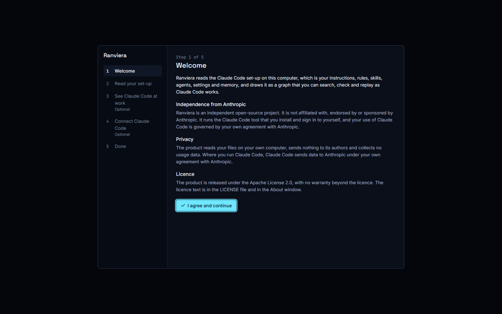
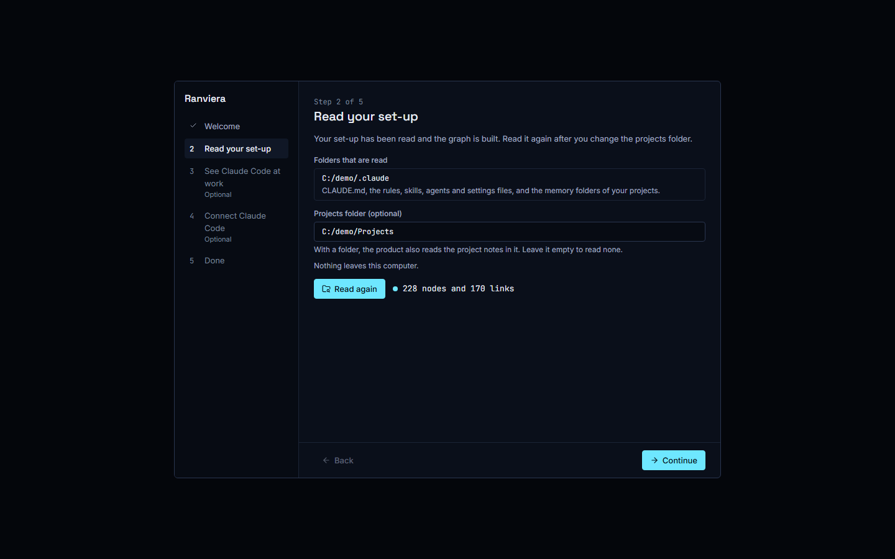
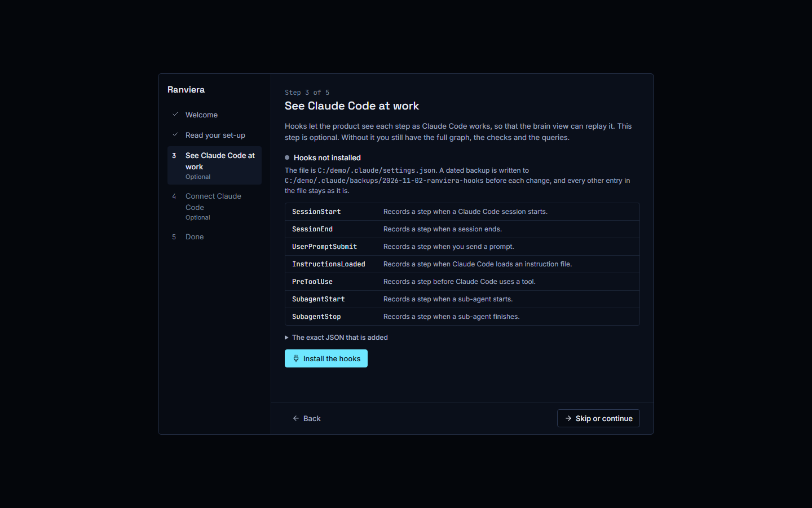
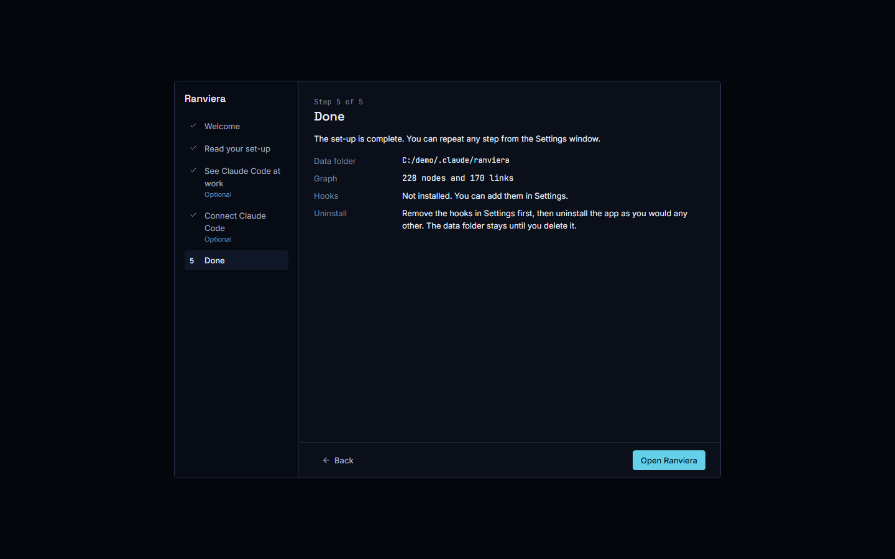

# The first run

The first time you open Ranviera, a window with 5 steps guides you through the set-up. This guide explains what each step shows, what it reads, what it writes and how to repeat it later.

Only steps 1 and 2 are required. Steps 3 and 4 are marked Optional in the list on the left of the window, and you can skip both.

## Before you start

Ranviera reads files on your own computer. It does not need an account and it sends nothing to its authors. Claude Code is only needed for step 4 and for the features that run lessons or agents through it.

## Step 1, Welcome

The window explains what Ranviera does and shows three short statements:

- Independence from Anthropic. Ranviera is an independent open-source project and is not affiliated with, endorsed by or sponsored by Anthropic.
- Privacy. Ranviera reads your files on your own computer, sends nothing to its authors and collects no usage data. Where you run Claude Code, Claude Code sends data to Anthropic under your own agreement with Anthropic.
- Licence. Ranviera is released under the Apache License 2.0 and carries no warranty beyond the licence.

To continue:

1. Read the three statements.
2. Select **I agree and continue**.

Selecting the button records the date of your agreement in a file called setup.json in the data folder. The data folder is the folder where Ranviera keeps its own files, and its default is ~/.claude/ranviera, which on Windows is C:\Users\your-name\.claude\ranviera. No file is read from your Claude folder at this point. The window cannot be closed with the Escape key until you have agreed.

## Step 2, Read your set-up

This step builds the graph, which is a map of the items in your set-up (called nodes) and the references between them (called links). The brain view is the Graph window, which draws this map as a 3D brain. Nothing is read until you select the button, and everything stays on your computer.

The window lists the folders that are read. The first is your Claude folder, normally ~/.claude. From it, Ranviera reads CLAUDE.md, the rules, skills, agents and settings files, and the memory folders of your projects. If the folder is not found, the window says so and the graph starts from the starting vocabulary only.

The second field is the Projects folder, which is optional. If you enter a folder, Ranviera also reads the project notes in it. If you leave the field empty, it reads none.

To read your set-up:

1. Enter a Projects folder if you want one, for example C:/Users/you/Projects.
2. Select **Agree and read my set-up**.
3. Wait until the button says **Read again** and the window shows a count such as 228 nodes and 170 links.
4. Select **Continue**.

A node is one item of the set-up, such as a rule, a skill or a memory file. A link is a reference from one node to another. The **Continue** button stays disabled until the first read has finished.

Ranviera writes the graph to the data folder. It does not change any file in your Claude folder or your Projects folder in this step. Select **Read again** after you change the Projects folder or add files, and the graph is built again.

## Step 3, See Claude Code at work (optional)

A hook is a command that Claude Code runs when an event happens, such as the start of a session. Hooks let Ranviera see each step as Claude Code works, so that the brain view can replay it. Without hooks you still have the full graph, the checks and the queries.

This is the only step that writes outside the data folder. It changes the settings file and writes a backup of it in the backups folder of your Claude folder, normally ~/.claude/backups. The window shows the state, **Hooks not installed** or **Hooks installed**, and the path of the settings file that would change, normally ~/.claude/settings.json.

### What the hooks add

The installer adds one entry for each of these 7 events:

- SessionStart, when a Claude Code session starts.
- SessionEnd, when a session ends.
- UserPromptSubmit, when you send a prompt.
- InstructionsLoaded, when Claude Code loads an instruction file.
- PreToolUse, before Claude Code uses a tool.
- SubagentStart, when a sub-agent starts.
- SubagentStop, when a sub-agent finishes.

Each entry runs in the background and waits at most 10 seconds. Each one records a step in a monthly event file in the data folder. A prompt event holds the identifiers of the rules and terms that matched and not the text of the prompt, unless you change that in the configuration.

Select **The exact JSON that is added** to see the text, and select **Copy** if you want to keep it.

### How the install is made safe

The installer merges its entries into your settings file. It keeps every other entry as it was, and it writes a dated backup to the backups folder inside your Claude folder, normally ~/.claude/backups, before each change. If the settings file is not valid JSON, the installer leaves it untouched and shows a message.

To install the hooks:

1. Select **Install the hooks**.
2. Read the message, which gives the folder of the backup.
3. Select **Skip or continue**.

To skip the step, select **Skip or continue** without installing.

### How to remove the hooks

Removal deletes only the Ranviera entries and keeps the rest of your settings file. A backup is written first.

1. Open the Settings window by selecting Settings in the dock, or by pressing Alt and 9.
2. In the Hooks section, select **Remove the hooks**.
3. Read the message, which gives the number of entries removed.

Remove the hooks before you uninstall the app, because Claude Code would otherwise keep trying to run commands that no longer exist.

## Step 4, Connect Claude Code (optional)

This step has no screenshot. It checks whether Claude Code is installed and signed in, so that Ranviera can start lessons and agent runs through it. The window shows one of four states. The first is **Claude Code not checked**. The window shows it before it has read the state of Claude Code. The other three are:

- **Claude Code not installed**. Select **Anthropic installation page**, install Claude Code, and return to the window. The window checks again when you return, and you can also select **Check again**.
- **Claude Code sign-in needed**. Claude Code is installed but not signed in. Select **Sign in with Claude Code**.
- **Claude Code signed in**. The window shows the version and, where known, the sign-in method and plan.

The sign-in button opens a terminal window that belongs to Claude Code. You sign in there. Ranviera never asks for a password, a code or a key. While it waits, it checks every 3 seconds for up to 5 minutes. If the sign-in is not completed in that time, select the button again.

Select **Skip or continue** when you have finished or if you want to skip the step.

## Step 5, Done

The last step summarises the set-up:

- Data folder. The folder where Ranviera keeps the graph, the event files and its settings. The default is ~/.claude/ranviera, which on Windows is C:\Users\your-name\.claude\ranviera.
- Graph. The number of nodes and links, or Not built yet.
- Hooks. Whether the hooks are installed or not.
- Uninstall. Remove the hooks in Settings first, then uninstall the app as you would any other. The uninstaller may also offer to remove the hooks. The data folder stays until you delete it.

Select **Open Ranviera** to close the window and start using the app.

## Repeat a step from Settings

You can repeat the first run at any time.

1. Open the Settings window by selecting Settings in the dock, or by pressing Alt and 9.
2. In the First run section, select **Repeat the steps**. The section also shows the date on which you agreed to the terms.
3. The window opens at step 2, Read your set-up. The **Continue** and **Back** buttons move between steps.

Nothing is read or installed until you agree to the step that does it. Settings also holds each step on its own:

- Projects folder and set-up. Change the folder and select **Save and read again**.
- Hooks. Install or remove the hooks.
- Claude Code. Check the state and sign in.

## What the first run changes

| Step | Reads | Writes |
|---|---|---|
| 1, Welcome | Nothing | The date of your agreement, in setup.json in the data folder |
| 2, Read your set-up | The Claude folder and the optional Projects folder | The graph, in the data folder |
| 3, See Claude Code at work | Your settings file | The hook entries in settings.json, and a backup in the backups folder of the Claude folder |
| 4, Connect Claude Code | The state of Claude Code on your computer | Nothing |
| 5, Done | The counts and the hook state | Nothing |
