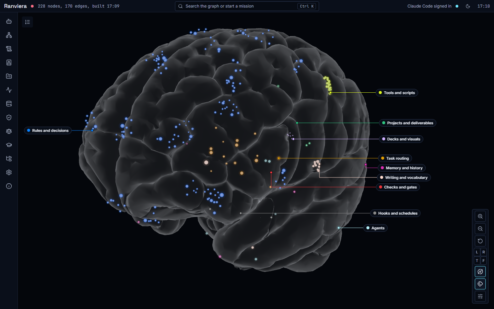
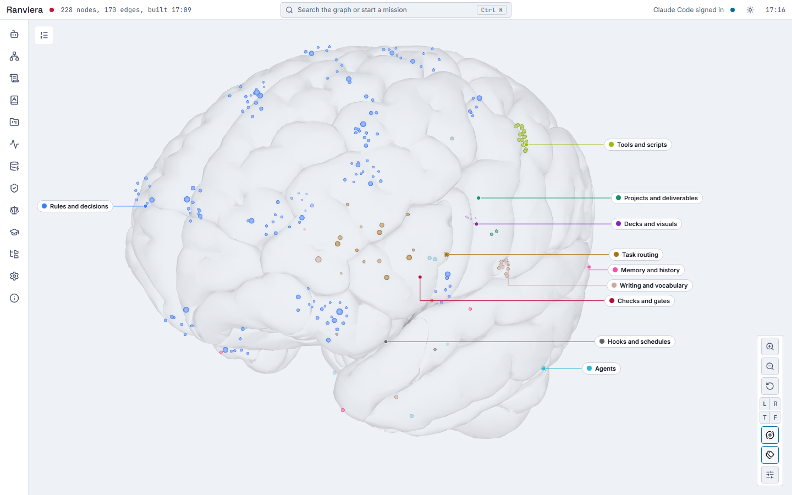
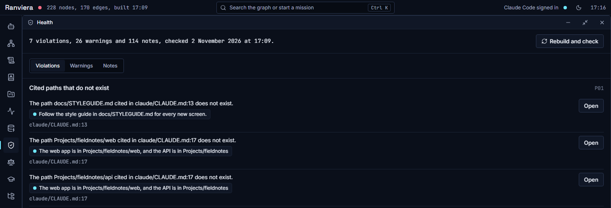

# Reading the graph and the checks

This guide explains how to read the brain view in the Graph window and how to use the Health window to find broken references and conflicting rules. It ends with a short note on the other windows.

## The brain view

The Graph window draws each part of your Claude Code set-up as a node. A node can be a rule, a skill, an agent, a hook, a memory file or a project. A link between two nodes means that one refers to the other. Each node in the brain layout belongs to the region of the brain that matches its job. The window also has a light theme.

To open the window, choose Graph in the dock, or press Alt and 2.

### Layers

The Layer switch in the Graph window has two choices. Structure shows your Claude Code set-up as described in this guide. Knowledge replaces it with a map of the claims that you extract from linked sources. The Sources guide explains how to link and extract them.

### Regions

The Regions list on the left of the window names ten regions. Each region holds one kind of information, and the number beside its name is the count of nodes in it.

| Region | What it holds |
|---|---|
| Rules and decisions | Instruction, map, rule and reference files, skills, sections, rules and decisions |
| Writing and vocabulary | Concepts, the output style and instructions about writing |
| Decks and visuals | Templates and instructions about decks, charts and design |
| Tools and scripts | Tools and launch configurations |
| Projects and deliverables | Projects, apps, deliverables, open items, organisations and people |
| Memory and history | Memory files, record stores and history files |
| Checks and gates | Gates, fault checks and findings |
| Task routing | Task types and routes |
| Agents | Agents |
| Hooks and schedules | Hooks and scheduled tasks |

Under each name the list also gives the part of the human brain that the region is named after. This is a visual aid only.

You can do three things with the list:

1. Select a region name to turn the brain towards that region. Ranviera then lists the 10 hottest nodes of the region. A node is hot when it has been used often and recently.
2. Clear the box beside a name to hide that region.
3. Select Clear above the hot list to return to the whole brain.

### Colours

The coloured dot beside each node name shows its family. A family is a group of node types. The Legend section lists the families and how many nodes each holds:

- Instructions: rules, files, skills and task types.
- Machinery: agents, hooks, tools and gates.
- Records: memory files, backlog and decisions.
- Work: projects, apps and deliverables.
- World: clients, people and instruments.
- Language: vocabulary schemes and terms.
- Knowledge: claims, arguments, linked sources and learning sessions.

Clear the box beside a family to hide it. The Knowledge family holds the claims that you extract from linked sources, and it is the family you see in the Knowledge layer. The Sources guide explains how to link them.

### View settings

The View section changes how the graph looks:

- Layout switches between Brain and Network. Network draws the same nodes as a web of links.
- Size by sets the size of a node by Use or by Links.
- Show limits the graph by sensitivity. The choices are All material, Internal and public, and Public only.
- Slow orbit turns the brain gently.
- Label files, skills and projects adds names to those nodes.
- Show links not yet reviewed draws links that Ranviera has inferred and you have not reviewed. They are dashed and fainter.

The Replay section plays past use through the graph, so that you can see the nodes light up as they were used. Choose the last 7 days or the last 30 days. One day plays in about 4 seconds.

### Finding a node

Type in the Find a node box in the Graph window, and the matching nodes appear as chips under it. Press Enter to jump to the first match, or select a chip.

Ctrl K opens a search box over the whole app, and Command K does the same on macOS. The box is labelled Search the graph or start a mission. It can also start a mission, which is described below. The search field in the top bar opens the same box.

### Selecting a node

Select a node in the brain, or a chip in a list, to see its details on the right. The panel shows:

- the name of the node, its identifier and, where it comes from a file, the path with an Open button
- a short summary, when the file has one
- the date, status and sensitivity of the node, where sensitivity says how freely the node may be shared
- Properties, which are further facts that depend on the type of node
- Relations, which are the other nodes that this node links to or that link to it, grouped by kind
- Usage, which gives the number of uses, the date of the last use and a chart of events by week over the last 12 weeks
- Inferred about this node, which lists facts that Ranviera worked out from the links in the graph, for example that a rule applies to a task type because of the nodes between them

## The Health window

The Health window checks the graph for faults. To open it, choose Health in the dock, or press Alt and 7.

The line at the top gives the number of violations, warnings and notes, and the date and time of the last check. The three tabs below it, Violations, Warnings and Notes, show the findings of each kind:

- A violation is a fault that breaks a reference or a rule. A cited path that does not exist is an example.
- A warning is a fault that may cause a problem later, such as a file that is over its size limit.
- A note is information that may be useful and needs no action.

Each group of findings has a plain heading that names its check, such as Cited paths that do not exist. The identifier of the check, such as P01, appears at the right of the heading. Each finding gives a message, a chip for the node concerned and the evidence, which is usually a file and a line.

### Opening the file

Where the evidence is a path, an Open button appears beside the finding. Select it to open the file, so that you can correct the line.

### Checking again

After you correct a file, choose Rebuild and check. Ranviera reads your set-up again, redraws the graph and runs the checks. The button shows the seconds elapsed while it works, and a message appears when the rebuild is complete.

If a message says that the report describes an older build of the graph, choose Rebuild and check to bring it up to date.

### Drift

The Drift section at the bottom lists files that differ between ~/.claude and a mirror of it, which is a second copy of the set-up. It names the files that changed since the mirror was written and the files that appear in just one of the two places. If the check has not run, the section says so.

## The other windows

Each of these opens from the dock.

- Rules lists the rules in each file and task type, and has a box to search the text of the rules. Press Alt and 3.
- Lexicon shows the vocabulary schemes with their terms and the forms to avoid, and lets you paste text to check it. Press Alt and 4.
- Projects lists the projects in your set-up with their state, such as active, parked or blocked, and opens the memory file of each. Press Alt and 5.
- Pulse shows a live feed of events, the nodes used most in the last 30 days, and the instruction files, skills and agents not used in 60 days. Press Alt and 6.
- Query has an Ask tab, which runs a query on the graph, and an Inferred tab, which lists the rules and facts that Ranviera worked out from the links in the graph. Press Alt and 8.
- Missions starts a task that you describe in your own words and shows the nodes that it will fire, the files it reads first, its steps and its gates. Press Alt and 1.
