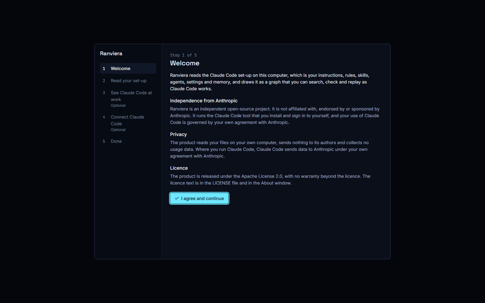
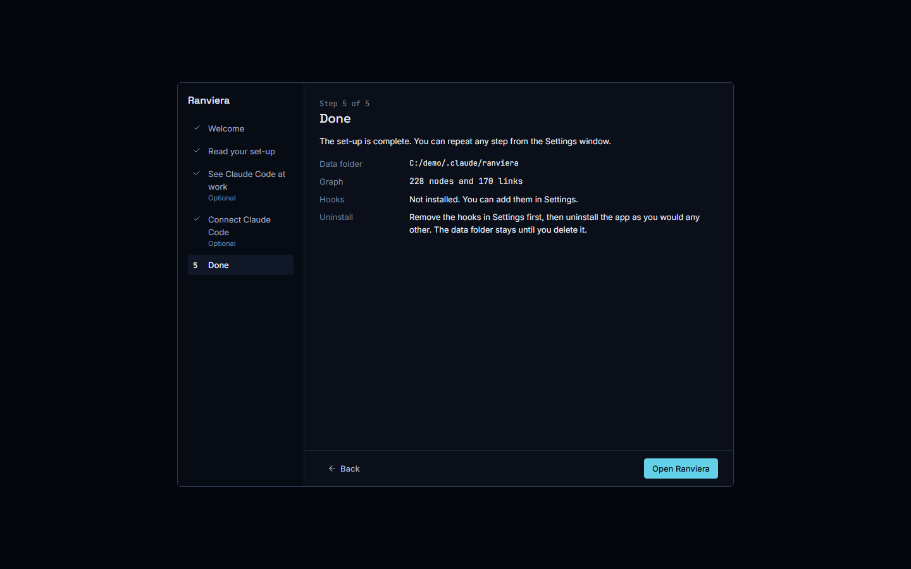
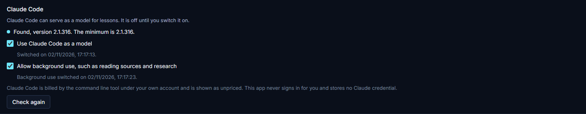

# Installing Ranviera

This guide shows how to download, check, install and open Ranviera on Windows, macOS and Linux. It then explains how to set up Claude Code for lessons and how to remove Ranviera and its data. Ranviera is an independent open-source project. It is not affiliated with, endorsed by or sponsored by Anthropic.

## Before you start

The installer carries all that Ranviera needs. You do not need Python, Node or Git. The first releases are not code-signed, so no company has vouched for the file. Windows and macOS may ask you to confirm the first start, and the steps below show where. The app has no automatic update. To receive a new version, download it again from the Releases page.

## Downloading the installer

1. Open the Releases page at https://github.com/JinaJaundice/ranviera/releases.
2. Open the newest release and find the list of files under Assets.
3. Download the file for your computer:

| Computer | File |
|---|---|
| Windows | `Ranviera-Setup-<version>.exe` |
| macOS with Apple silicon (M1 or later) | `Ranviera-<version>-arm64.dmg` |
| macOS with an Intel processor | `Ranviera-<version>-x64.dmg` |
| Linux | `Ranviera-<version>-<arch>.AppImage` |

On a Mac, open the Apple menu, choose About This Mac and read the chip. A name that starts with Apple means Apple silicon. A name that starts with Intel means Intel.

4. Download the file `SHA256SUMS.txt` from the same release.

## Checking the download

A checksum is a short code worked out from the file. If your code matches the one in `SHA256SUMS.txt`, the file arrived complete and unchanged. Check it before you open the file.

1. Put the installer and `SHA256SUMS.txt` in one folder.
2. On Windows, open PowerShell in that folder and run `Get-FileHash .\Ranviera-Setup-<version>.exe -Algorithm SHA256`. Check that the value it prints matches the line for that file in `SHA256SUMS.txt`.
3. On macOS, run `shasum -a 256 <file>` in Terminal. Check the value against `SHA256SUMS.txt` in the same way.
4. On Linux, run `sha256sum --check --ignore-missing SHA256SUMS.txt`. The line for your file should end with OK.

You can also check the build attestation, which shows that GitHub built the file from the Ranviera repository. Install the GitHub command line tool and run `gh attestation verify <installer file> --repo JinaJaundice/ranviera`.

## Installing on Windows

1. Double-click `Ranviera-Setup-<version>.exe`. The installer is for one user and needs no administrator rights.
2. Windows SmartScreen may show the message Windows protected your PC. Choose More info, then choose Run anyway.
3. Wait for the installer to finish. Ranviera opens, and the installer adds a desktop shortcut and a Start menu entry named Ranviera.

## Installing on macOS

The macOS builds are not signed or notarised by Apple, so macOS blocks the first start of a downloaded copy. The steps below follow the route that Apple documents for an app from a developer it has not identified. They have not yet been tried on every version of macOS, so a screen on your Mac may look different.

1. Open the DMG file and drag Ranviera to the Applications folder.
2. Open Ranviera from the Applications folder. macOS says that it cannot verify the app. Choose Done.
3. Open System Settings, then Privacy and Security, and scroll to the Security section.
4. Choose Open Anyway next to the message about Ranviera, then confirm with your login password.
5. If Open Anyway does not appear, open Terminal, run `xattr -dr com.apple.quarantine /Applications/Ranviera.app` and open Ranviera again. The command removes the mark that macOS puts on downloaded files.

## Installing on Linux

1. Open a terminal in the folder that holds the download.
2. Make the file executable with `chmod +x Ranviera-<version>-<arch>.AppImage`.
3. Run it with `./Ranviera-<version>-<arch>.AppImage`.

Some Linux distributions need the FUSE 2 library before they can run an AppImage. If the file does not start and the terminal mentions FUSE, install the FUSE 2 package for your distribution and try again. The package name differs between distributions, and the maintainers have not tested every one.

## The first run

When Ranviera opens for the first time, a set-up window of 5 steps appears. The steps are Welcome, Read your set-up, See Claude Code at work, Connect Claude Code and Done. The third and fourth steps are optional, and you can also do them later in Settings. No file is read or changed until you agree to the step that does it.

The last step shows where the data folder is, whether the hooks are installed and how to uninstall.

## Setting up Claude Code for lessons

Lessons can run on Claude Code, on a provider with an API key, or on a model on your own computer. This section is only for lessons through Claude Code. Ranviera does not include, download or change Claude Code. It uses the copy that you install.

1. Install Claude Code with the steps at https://docs.claude.com/en/docs/claude-code/setup.
2. Return to Ranviera and open Settings. The first section named Claude Code shows whether Ranviera found your copy. Lessons need version 2.1.316 or later.
3. If you are not signed in, choose Sign in with Claude Code. A terminal window opens, and you sign in there. Ranviera does not see your password or code. It checks each 3 seconds for up to 5 minutes and then shows that you are signed in.
4. Scroll down the Settings page to the second section named Claude Code, which comes after Provider keys. Switch on Use Claude Code as a model.
5. To let Ranviera use Claude Code for work you did not ask for directly, such as reading sources and research, also switch on Allow background use, such as reading sources and research. This switch can be used only after the first one is on.
6. After the first switch is on, the button Check again appears in this section. Choose it to read the version again.

Both switches are off until you turn them on.

Use of Claude Code is covered by your own agreement with Anthropic and your own plan.

## Uninstalling Ranviera

1. Open Settings and choose Remove the hooks to take the hook entries out of your `~/.claude/settings.json` file. Ranviera deletes only its own entries and keeps a dated backup. Do this before you uninstall, because the uninstaller does not remove them.
2. Uninstall the app. On Windows, open Apps in the Windows settings, choose Ranviera and uninstall it. On macOS, drag Ranviera out of the Applications folder. On Linux, delete the AppImage file.

Uninstalling does not change your Claude Code files, so remove the hooks in Settings first if you added them.

## Removing the data folder

The data folder remains on your computer after you uninstall. It holds the graph, the event log, the learning folder and the file of saved keys. The default folder is `~/.claude/ranviera`, which on Windows is `C:\Users\<name>\.claude\ranviera`.

1. Quit Ranviera.
2. Delete the `ranviera` folder inside your `.claude` folder.

Deleting the folder removes all sessions, claims and saved keys, and this cannot be undone. Copy the folder first if you may want the learning data later.

## Where to go next

The Releases page holds the newest installers. If a step on your computer does not match this guide, please open an issue on https://github.com/JinaJaundice/ranviera.
