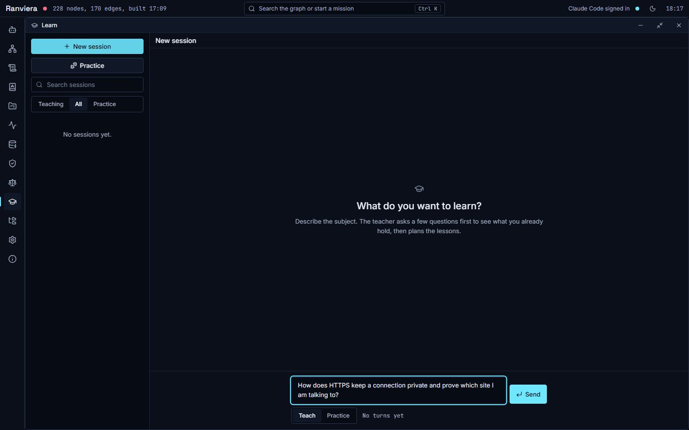
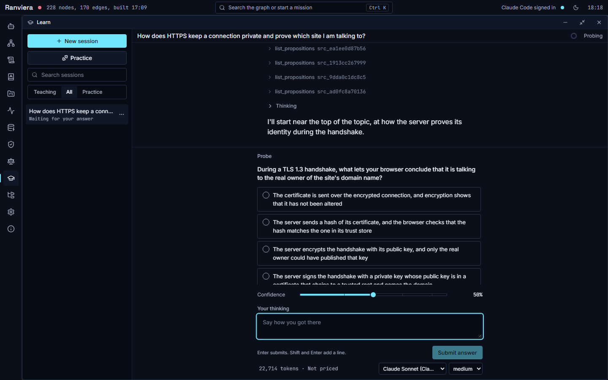
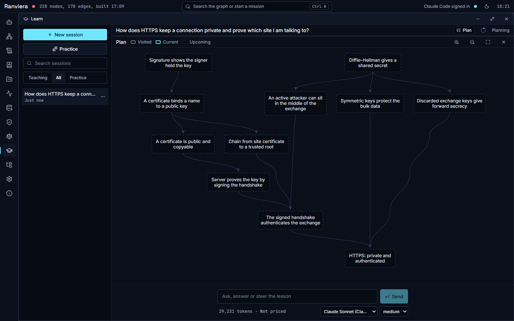
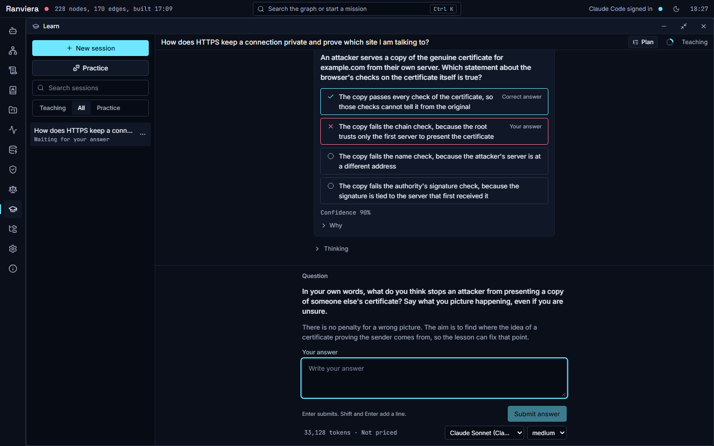
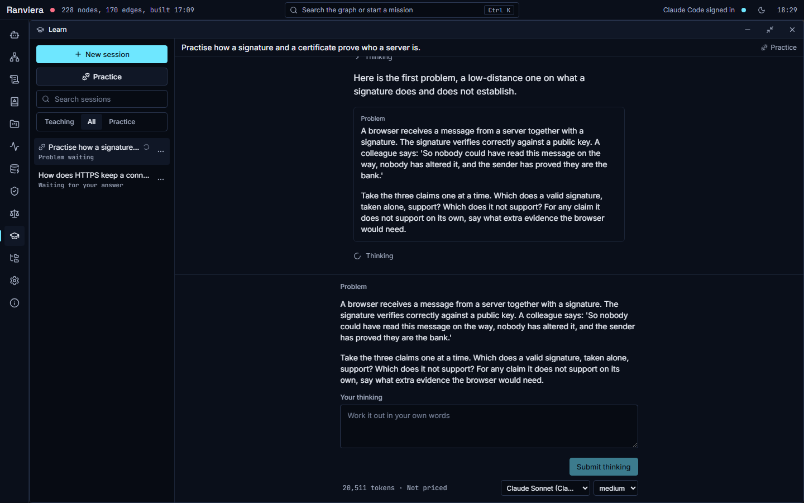
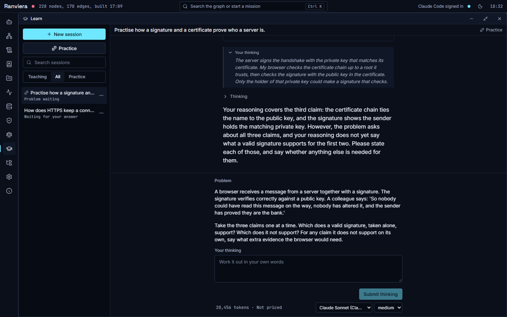

# Learning a topic

This guide shows how to learn a topic in the Learn window. It covers starting a session, answering the first questions, reading the plan, working through lessons, steering the teacher, practising, and how your answers change the Held state of a claim. You need a model for the lessons first. Open Settings and follow the model and key sections if the Learn window shows a notice at the foot of the window. The guide on linking sources explains how to link your notes, because the teacher draws on the claims that Ranviera extracts from them.

The Learn window has a list of sessions on the left and the open session on the right. In a narrow window the list is hidden, and the Show the sessions button opens it. The list has a search box and a filter named Kind of session with the choices Teaching, All and Practice. The menu on each session offers Rename, Export as Markdown and Delete.

## Starting a session

1. Open the Learn window and choose the New session button in the sessions list.
2. Check the switch at the foot of the window. Teach starts a lesson, and Practice starts a practice session (see the section on practice below).
3. Type what you want to learn in the box. The heading above the box reads What do you want to learn?
4. Press Enter, or choose Send. Shift and Enter add a new line.

A session is saved only after you send the first message, which means an empty new session leaves no trace. If the session cannot start, your words remain in the box.

## The first questions

The teacher does not begin by teaching. It first asks a few questions to see what you already hold, one at a time. The session bar shows the stage as Probing, then Planning, then Teaching. The questions find the edge of what you know, and a wrong answer does not count against you.

A question appears at the foot of the window. Before the teacher asks it, you may see the tool calls the teacher made to read the claims in your graph, listed above the question.

To answer a question:

1. Read the question and the options. The words Select all that apply mean that more than one option may be right.
2. Choose an option. In a quiz question you can choose I do not know when you have no idea. In other questions a row at the end lets you type your own answer.
3. Set your confidence with the slider. The stops are 0%, 30%, 50%, 70%, 90% and 100%. The arrow keys move between the stops. Confidence is switched off and shown as Not given when you choose I do not know.
4. Write your reasoning in the box Your thinking, in a few words. The box shows the hint Say how you got there.
5. Choose Submit answer. Enter also submits, and Shift and Enter add a line.

Some questions ask for a written answer only. These show a box named Your answer with the hint Write your answer, and they have no options or slider.

The teacher reads your confidence next to the result, and it reads your thinking in full. A confident wrong answer tells the teacher more than a hesitant one, because it points to a belief that needs repair. Answer with the confidence you really have, because an honest low score helps the teacher choose the next step.

## The plan map

When the teacher has seen enough, it draws a plan. The plan is a route of steps from what you already hold to your goal. Each step is a node, and a line from one node to another means that the first step comes before the second. The teacher describes the approach in a few sentences and asks whether the plan should change. The lesson does not begin until you reply.

A Plan button appears in the session bar once a plan exists. A card for the plan also appears in the conversation, and either one opens the plan window. The window offers Zoom in, Zoom out, Fit the plan and Close the plan.

The legend explains the three states of a step:

- Visited means you have already worked through this step.
- Current means this is the step the lesson is on now.
- Upcoming means you have not reached this step yet.

Ranviera works out the current step from the newest check that the teacher set. The map therefore follows your progress without any action from you.

To answer the teacher's question about the plan:

1. Choose the Plan button, or the plan card in the conversation, and read the route.
2. Shut the plan window with its Close the plan button.
3. Type your reply in the message box, whose hint reads Ask, answer or steer the lesson. To accept the plan, you can write "That plan looks good. Please start."
4. Press Enter, or choose Send. To change the plan, say what you would like to change instead.

## Lessons and checks

The teacher moves one step at a time. For each step the usual order is a prediction, the teaching and then a check. The prediction asks what you expect before the step is taught, and the teaching begins by saying what was true and why. The check is a question about the step you have just read. A wrong option in a check is written to match one common misunderstanding. A miss therefore shows which idea needs repair, and the teacher repairs it before building on it.

A check does not interrupt your reading. It waits behind a bar that reads Check your understanding, with an Open button. While you read, the box Thinking while reading is available above the bar. It is for notes on what you notice, such as a phrase you did not follow. The note is kept with your answer and the teacher reads it.

1. Read the lesson text. It may include diagrams and formulas.
2. Write anything you notice in Thinking while reading. This is optional.
3. Choose Open on the bar Check your understanding.
4. Answer the check in the same way as the first questions, then choose Submit answer.

After you submit, the check shows the correct answer and your own answer, each marked on its option. It also shows the confidence you gave. Choose Why to read the reason for the correct answer.

The teacher then explains the result and either moves to the next step or repairs the step you missed. The next question may ask for a free answer. It shows a box named Your answer and no options. Write the answer in your own words and choose Submit answer. Your words then appear under the label Your answer.

## Steering the lesson

The box at the foot of the window is for talking to the teacher. Its hint reads Ask, answer or steer the lesson. You can ask a question, ask for a simpler example, ask for a step to be skipped or ask for the plan to change.

While the teacher is writing, a message that you send is queued as a steer. It appears above the box in small text and the teacher reads it at the next point where it can take it into account. If you press Enter on an empty box while the teacher is writing, Ranviera asks Abort this turn? before it stops. The Stop button does the same.

The folded bar at the foot appears when you scroll up to read earlier text. Scroll back to the bottom and the question or box opens again.

## Practice sessions

A practice session sets problems for you to solve in your own words, one at a time. It does not teach new material first. It suits the time after a lesson, or claims you already hold.

1. Open a new session and choose Practice at the foot of the window. The heading changes to What do you want to practise?
2. Say what to practise in one of three ways. Choose Pick claims to open a list of the claims in your graph, search for them and tick up to the limit shown as picked of the maximum, then choose Done. Or type a topic in the box. Or give the path of a file.
3. Send the message. The teacher sets a first problem.
4. Read the problem. Write your working in the box Your thinking, which shows the hint Work it out in your own words.
5. Choose Submit thinking. The teacher reads your working and shows it back to you.
6. If the working is incomplete, the teacher says what it covered and asks for more. Add to your working in the same way and choose Submit thinking again.
7. When the problem is done, choose Next problem, or press Enter on an empty box. You can ask a question first. The hint reads Ask anything, or press Enter for the next problem.

The button Next problem appears only when the problem is done. Until then the teacher may ask for more, and the same problem remains open.

You can ask for a hint in the message box during a problem. The teacher gives hints in steps, from a nudge on where to look up to a worked step, and gives one step for each request. A problem solved with no hint, or with the lightest hints, counts more strongly towards a claim being held than one solved with a worked step. The teacher sets a new problem only when you ask for one. It aims to keep problems hard enough that you succeed about 85 in 100 times, and the difficulty goes up after a clean success and down after a miss.

## How answers change a claim

Each claim in the Knowledge layer of the Graph window shows a Held state. This is a status word that says how well your answers show that you hold the claim. It is worked out from your graded answers and practice outcomes, and it cannot be typed by hand.

Open a claim to see its card. The card shows these fields:

- Held has three values, which are Not yet tested, Shaky and Held.
- Not yet tested means no answer is recorded for the claim.
- Shaky means the answers so far do not yet show that you hold it.
- Held means that your 2 newest answers on the claim were correct, with no hint heavier than a redirect or a nudge. It also means that none of your 3 newest answers was a structural miss, which is a miss that shows the idea itself is wrong.
- Last tested gives the date of the newest answer.
- Calibration compares your confidence with your accuracy. It reads Not yet measured until you have given 5 answers with a confidence, and then Calibrated, Overconfident or Underconfident.

A single correct answer therefore leaves a claim Shaky, because one answer is thin evidence. A claim also falls back to Shaky if a later answer is wrong or needs a heavy hint. The state changes after the teacher records the outcome of a check or a problem, and the open Graph window refreshes when this happens.

The Knowledge layer, the claim card and the passage view are described in the guides on linking sources and on the graph. The Held state describes your answers in Ranviera only, and it does not prove that you understand a subject.

## Choosing a model

A session uses the model set in the foot of the window. The Model menu there lists the models you have set up, and the Thinking level menu changes how much the model reasons before it replies. If the menu reads Choose a model, open Settings and set up Claude Code, a provider key or a local model first. The foot also shows the context used, the cost, the cache hits and the number of turns.

## Deleting a session

Choose Delete from the menu of a session, then choose what happens to the knowledge it produced. Keep the claims it produced leaves the claims and arguments in the graph and removes only the session. Remove the claims that only this session supports also removes those claims, while a claim that another source supports remains. A deletion cannot be undone.
