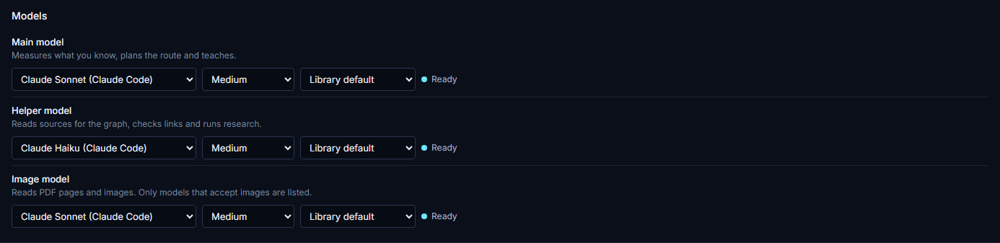
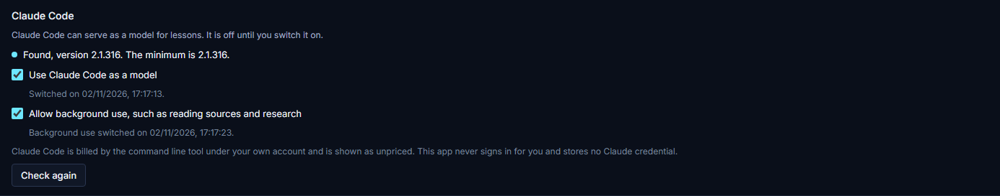
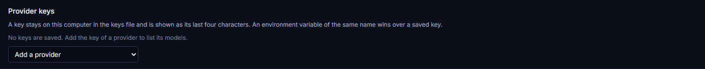

# Choosing models

Ranviera needs a model before it can teach you or read your sources. This guide explains the three model slots and how to fill them with Claude Code, a provider key or a model on your own computer. It also explains which models may read Client confidential sources. All of these choices are in Settings.

## The three slots

Settings has a section called Models with three slots. Each slot holds one model and has its own thinking level and prompt cache choice.

| Slot | What it does |
|---|---|
| Main model | Measures what you know, plans the route and teaches. |
| Helper model | Reads sources for the graph, checks links and runs research. |
| Image model | Reads PDF pages and images. Only models that accept images are listed. |

The thinking level sets how much the model reasons before it answers. A model that does not reason offers only Off. If you change to a model that does not support the level you chose, Ranviera moves to the nearest level that the new model supports.

The prompt cache choice has four options, Library default, No caching, Short retention and Long retention. Leave it on Library default unless you have a reason to change it.

Each slot shows one of four states next to it:

- Ready means a model is chosen and its provider can be used.
- Needed means the slot holds no model.
- Key missing means the model belongs to a provider that has no key.
- Not listed means the saved model is no longer in the list of its provider.

You must choose a model for all three slots before you start a lesson or read sources. Until you do, the Models section says "Choose a model for each of the three slots before you start a lesson or read sources." Ranviera also refuses the task and names the empty slots.

## Using Claude Code

If Claude Code is installed and you have signed in to it, Ranviera can use it as a model. This is the quickest way to fill the slots, as it needs no key.

1. Open Settings and go to the Claude Code section.
2. Switch on Use Claude Code as a model. It is off until you do this.
3. Read the status line. A version of 2.1.316 or later shows as Found with the version number. This is the minimum that Ranviera accepts.
4. If you installed or updated Claude Code just now, choose Check again. The button appears once the first switch is on.
5. Open the Models section and choose the entries listed under the group heading claude-code in each slot.

The status line can also say Off, Not found, or that the version is below the minimum. Not found means Ranviera could not find the command line tool. Install Claude Code and sign in to it outside Ranviera, then choose Check again. If the version is too low, update Claude Code and check again.

A second switch, Allow background use, such as reading sources and research, lets Ranviera use Claude Code for jobs that run without you in a lesson. You can switch it on only after the first switch. While it is off, Claude Code is not used to read sources, and a Helper model that uses Claude Code is refused for that work. Ranviera records the time at which you switched each one on.

Claude Code is billed by the command line tool under your own account, and Ranviera shows these models as unpriced. Ranviera does not sign in for you and stores no Claude credential.

## Adding a provider key

Instead of Claude Code, or as well as it, you can add the key of a model provider. The models of that provider then appear in the slots.

1. Open Settings and go to the Provider keys section.
2. Open the menu Add a provider and choose the provider.
3. Paste the key and choose Save.
4. Open the Models section and choose models from that provider.

Until you add a key, the section reads No keys are saved. The same menu offers keys for Tavily and Brave web search, which the research feature uses to search the web. Once a key is saved, a link called Where to create a key appears beside it for the providers whose key page Ranviera knows.

A saved key remains on your computer in the keys file, which is `~/.claude/ranviera/auth.json` by default. Ranviera shows the key only as its last four characters and its length. The state word beside it is Connected. To change a saved key, choose Replace. To delete it, choose Remove.

An environment variable of the same name wins over a saved key. For example, if `ANTHROPIC_API_KEY` is set in the environment that starts Ranviera, Ranviera uses it and shows the state Set by an environment variable. A key of the same name in the keys file is then not used, and Ranviera says so under the key. A key that comes only from the environment cannot be replaced or removed in Settings.

## Using a model on your own computer

A custom endpoint is any server that speaks the OpenAI chat completions interface. Tools such as Ollama and LM Studio run models on your own computer in this way. The Custom endpoint section also accepts a hosted server, with or without a key.

1. Launch your model server and note its address. Ollama, for example, is usually at `http://localhost:11434/v1`.
2. Open Settings and go to the Custom endpoint section.
3. Type the address in Base URL.
4. Under Authentication, choose Keyless if the server needs no key, or API key if it does. For an API key, paste it in the box that appears.
5. If the server does not list its models, type their ids in the box Model ids to add by hand, separated by commas or spaces.
6. If the server runs on your own computer or network, switch on This endpoint runs on my own machine or network.
7. Choose Connect. After a connection the button reads Connect again, and a Disconnect button appears.

When the connection works, Ranviera shows the address it is connected to and says whether it counts the endpoint as local or hosted. The models of the endpoint then appear in the slots.

An address on the same computer, such as `localhost` or `127.0.0.1`, counts as local at once. For any other address, Ranviera counts the endpoint as local only if you switch on This endpoint runs on my own machine or network. Switch it on only when no one outside your own network can read what the endpoint receives. A key for the endpoint is stored in the keys file and is tied to the address it was saved for. If the environment variable `CUSTOM_OPENAI_API_KEY` is set, it wins over the stored key.

After you connect, the list Models of the endpoint shows what each model accepts, such as images and reasoning, with its context size and output size. If the server does not report a size, Ranviera assumes a context of 8,192 tokens and an output of 4,096 tokens. You can type your own context size, output size and reasoning choice beside a model and choose Save pins. A pin overrides what the endpoint reports.

## Models and Client confidential sources

Each linked source has a sensitivity, which is Public, Internal or Client confidential. Ranviera also sorts each model into one of three classes:

- Claude Code, for the models that run through the Claude Code tool.
- Local, for a custom endpoint on your own computer or network.
- Hosted, for all other models, because its provider runs it outside your computer.

A hosted provider is a model service that runs outside your computer. What may read a source depends on its sensitivity:

- A source marked Public or Internal may be read by the model you chose, wherever it runs. In Sources, the Hosted providers switch shows Allowed and cannot be changed. The line beside it reads "Allowed, because this root is not client confidential."
- A source marked Client confidential may be read only by Claude Code, which runs under your own agreement with Anthropic, or by a model on your own computer or network. A hosted provider may read it only after you switch on Hosted providers for that source.

To allow a hosted provider to read a Client confidential source, open the source in Sources and switch on Allow hosted providers to read, followed by the name of the source. Ranviera records the date and shows "Allowed since" with that date. Switching it off stops any further text from that source going to a hosted provider.

If a task would send Client confidential material to a hosted model without consent, Ranviera refuses it before any model call. The message reads "This material is client-confidential and the chosen model is hosted. Choose Claude Code or a local model, or record consent for the source in Sources."

Ranviera applies the same check to what a lesson reads. A lesson that has used Client confidential material takes that sensitivity for the rest of the session. If a task is refused, change the slots in Settings and start the task again.

Ranviera allows Claude Code for Client confidential material because the command line tool runs under your own account. Before you use it with material that a client has given you, check that your agreement with the client and your Claude account allow it.
