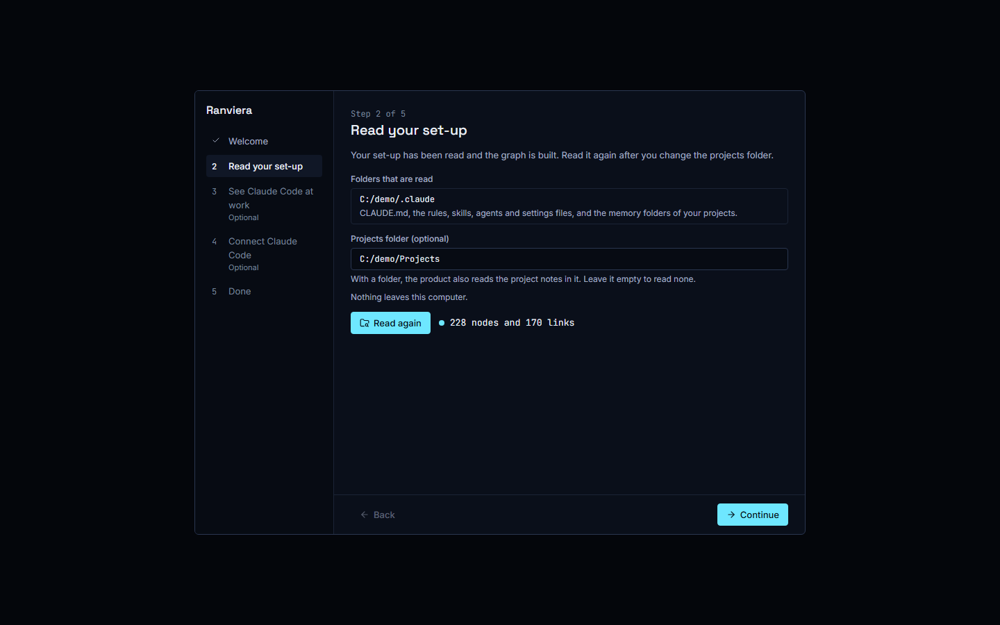
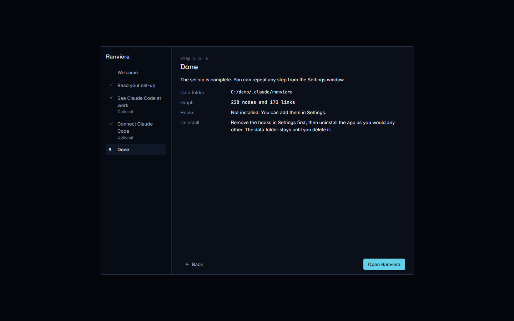
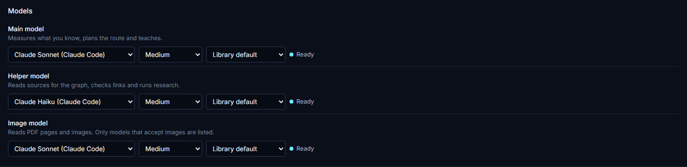
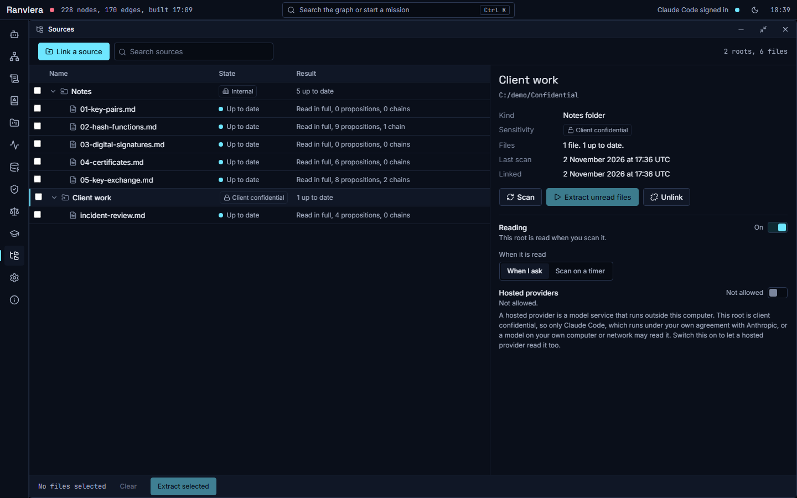
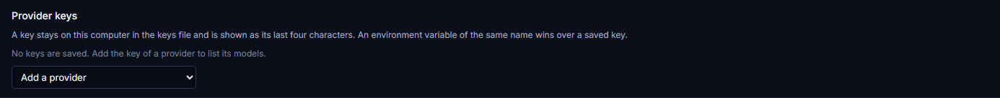
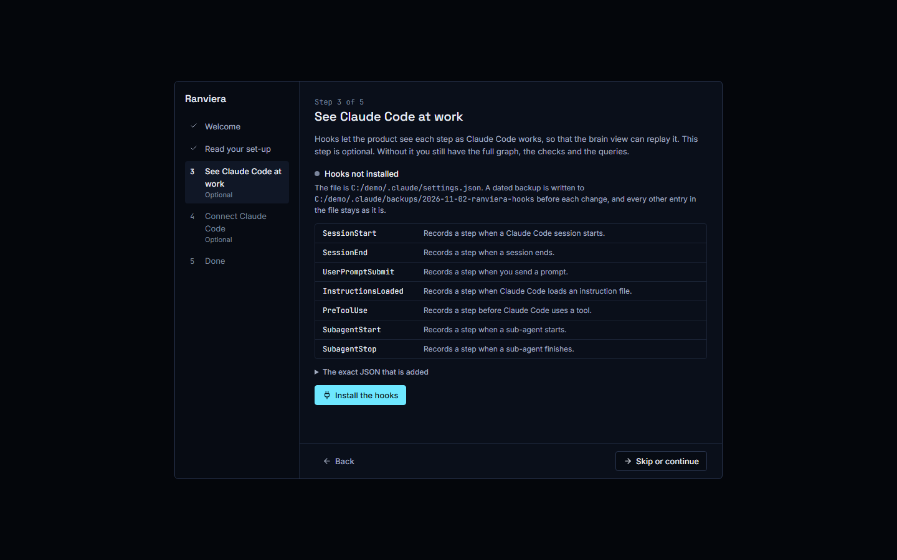

# Privacy and your data

This guide explains what Ranviera reads, what it writes and where it keeps it, what leaves your computer, and how to back up, move or delete your data. Ranviera is an independent open-source project. It is not affiliated with, endorsed by or sponsored by Anthropic, and it is not affiliated with LearnHarness, whose data format it shares. The full notice is in `PRIVACY.md` in the repository.

## In short

Ranviera works on your own computer. It has no account, no analytics and no tracking code, and the authors run no service that receives your files or any information about how you use the app. Text leaves your computer only when you run a lesson or an extraction on a model that you chose, and then it goes only to that model.

## What Ranviera reads

Ranviera reads nothing until you agree to the step that does it in the first run.

1. In step 2, Read your set-up, Ranviera lists the folders it will read. These are your Claude Code folder, normally `~/.claude`, and a projects folder if you choose one.
2. Ranviera reads the CLAUDE.md file, rules, skills, agents, output styles, settings and memory in the Claude Code folder.
3. For learning, Ranviera reads only the folders that you link in the Sources window. A scan reads these files where they are and never changes them.

Ranviera builds a graph from what it reads. The graph holds the text of rules and headings, file paths, dates, names and the links between them. It can therefore hold personal or confidential content from your own files, so treat your data folder as private.

## What Ranviera writes and where

Ranviera writes to four places.

- **The data folder.** By default this is `~/.claude/ranviera`. On Windows it is `C:\Users\<name>\.claude\ranviera`. It holds the graph, the results of checks, the record of events and agent runs, the record of your agreements, a copy of the hook program and the log of the local server.
- **The learning folder.** This is the folder `learn` inside the data folder. It holds the list of linked sources, the claims that Ranviera extracts with links back to the source lines, your learning sessions, your model settings and a folder called `archive`. The format is version 1 of the LearnHarness data format.
- **The keys file.** This is `auth.json` in the data folder. It holds the API keys that you paste into Settings. Ranviera keeps the previous version beside it as `auth.json.bak`.
- **The Claude Code settings.** If you agree in step 3 of the first run, Ranviera adds entries called hooks (see Remove the hooks below) to `~/.claude/settings.json`. It saves a dated backup first and leaves every other entry as it was.

Settings also shows the data folder in its Data folder section. Ranviera does not store the text of your prompts unless you turn on the setting `log_prompt_snippets`. If you turn it on, Ranviera stores the first 120 characters of each prompt.

## What leaves your computer

Ranviera does not send your files, your graph or your usage to its authors or to anyone else, and the app contains no code that does so. Three things use the network, and you control each of them.

1. **A lesson or an extraction.** The text of the request goes to the model that you chose in Settings, under your own agreement with that model's provider.
2. **Web search.** The research feature searches the web only if you have saved a Tavily or a Brave key. It then sends its search queries to that service.
3. **Claude Code.** If you run Claude Code through Ranviera, Claude Code sends the prompt, the files it reads and its output to Anthropic, under your own agreement with Anthropic. Ranviera does not see your password or your sign-in code, and it does not read the email address of your account. Ranviera does not include, download or change Claude Code.

Ranviera does not update itself. A new version is a new download from the Releases page at https://github.com/JinaJaundice/ranviera/releases.

The local server that runs behind the window listens only on the address 127.0.0.1 and refuses any request without a random token created at each launch. Other computers on your network cannot reach it.

### Which model receives your text

You choose one of three kinds of model for each slot in Settings, under Models.

- **Claude Code.** The text goes to Anthropic through Claude Code.
- **A hosted provider.** This is a model service that runs outside your computer and that you reach with an API key. The text goes to that provider.
- **A local model.** This is a model on your own computer or network. The text goes to the address that you entered. Ranviera treats an address on `localhost`, `127.0.0.1` or `[::1]` as local. For any other address, Ranviera treats the model as hosted unless you state that it runs on your own machine or network.

## Client confidential sources

Each source that you link has a sensitivity label of Public, Internal or Client confidential. The label controls where the text of the source may go.

A source with the label Public or Internal may be read by the model that you chose, wherever that model runs. A source with the label Client confidential may be read only by Claude Code, which runs under your own agreement with Anthropic, or by a model on your own computer or network. A hosted provider may read it only after you switch on Hosted providers for that source.

Before any model call, the server checks the label. If the source is Client confidential, the chosen model is hosted and you have not given consent, the server refuses the request and sends nothing. This check applies to extraction and to lessons. If a request uses several sources, it is refused when any one of them fails the check. The refusal message reads 'This material is client-confidential and the chosen model is hosted. Choose Claude Code or a local model, or record consent for the source in Sources.'

Ranviera gives these labels to new sources unless you change them:

- **Internal** for notes, PDF files, Claude instructions and LearnHarness folders.
- **Client confidential** for Claude memory, Claude Code transcripts and project Markdown.

The Sources window shows the switch under Hosted providers. For a source marked Public or Internal, the line reads 'Allowed, because this root is not client confidential.' The switch shows Allowed and cannot be changed. For a Client confidential source, the line reads 'Not allowed.' and the switch shows Not allowed until you switch it on.

You choose the label in the form Link a source, in the field Sensitivity. If you want a hosted provider to read the files of a Client confidential source, follow these steps:

1. Decide whether the files may be sent to a hosted provider. Ranviera cannot decide this for you.
2. In the Sources window, select the source.
3. Under Hosted providers, switch on Allow hosted providers to read, followed by the name of the source.
4. Check that the line now reads Allowed since, followed by the date. The switch records the date and applies to that source only.

To withdraw the consent, switch it off. Ranviera then sends no further text from that source to a hosted provider.

## API keys

Ranviera stores the keys that you paste in the file `auth.json` in the data folder. The file is plain text, and Ranviera sets it so that only your user account can read it where the file system supports that. Anyone who can read your data folder can read your keys.

- The Settings window shows a saved key only as its last four characters and its length.
- A key set as an environment variable before Ranviera starts takes precedence over the file. Settings then says 'An environment variable of the same name wins over the saved key, so the saved key is not used.'
- The file tools that Ranviera gives to its agents cannot read `auth.json`.
- To remove one key, open Settings, then Provider keys, and choose Remove next to it. The earlier file stays in `auth.json.bak` until you delete that file too.

## Back up your data

1. Quit Ranviera first. A running Ranviera holds a lock on the learning folder, and a copy made while it runs may be incomplete.
2. Copy the `learn` folder from the data folder to your backup location. Its files are plain JSON and JSON Lines.
3. Copy `auth.json` separately and store it more carefully, because it holds your keys. If you prefer, leave it out and paste the keys again after a restore.
4. To keep the graph and the record of events as well, copy the whole data folder.

## Move your data to another computer

1. Install Ranviera on the new computer from the Releases page.
2. Quit Ranviera on both computers.
3. Copy the data folder from the old computer into `~/.claude/ranviera` on the new one. To use another location, set the variable `CORTEX_DATA_DIR` to the new folder before you start Ranviera.
4. Open Ranviera on the new computer. The paths of your linked sources are kept as they were. If a folder is in a different place on the new computer, link it again in the Sources window.

## Delete data

- **One source.** In the Sources window select the source and choose Unlink. Ranviera asks you to choose a mode. Keep the knowledge leaves the claims in the graph. Delete the knowledge also deletes the claims that only these files support. Both modes move the removed lines to `learn/archive/<date>/` first and leave your own files unchanged.
- **One key.** Remove it in Settings, as described above.
- **All learning data.** After you quit Ranviera, delete the `learn` folder in the data folder, including its `archive` folder. Ranviera then starts the learning features again from the beginning.
- **Everything.** After you quit Ranviera, delete the data folder. This removes the graph, the learning data and the keys file together. Ranviera starts again from the beginning at the next launch.

Deleting a folder moves nothing to a bin that Ranviera controls, so make a backup first if you may need the data again.

## Remove the hooks

Hooks are entries in `~/.claude/settings.json` that let Ranviera see each step as Claude Code works. Ranviera adds them only if you agree in step 3 of the first run.

To remove them:

1. Open Settings.
2. Find the Hooks section.
3. Choose Remove the hooks.

Ranviera deletes only the entries that it added, keeps any other entry in `settings.json` and writes a backup. Remove the hooks before you uninstall the application. As a last option, restore the dated backup of `settings.json` that Ranviera saved before it added the entries, in `~/.claude/backups`.

Uninstalling the application does not change your Claude Code files and does not delete your data folder. If you added the hooks, remove them in Settings before you uninstall. Delete the data folder yourself if you want it gone.

## Questions

Raise a question about privacy as an issue in the public repository at https://github.com/JinaJaundice/ranviera. Please include no personal data in the issue.
