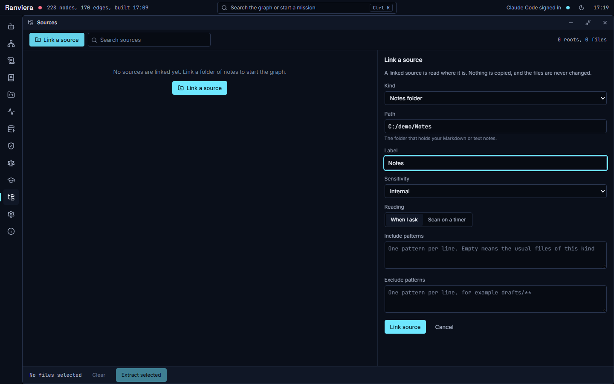
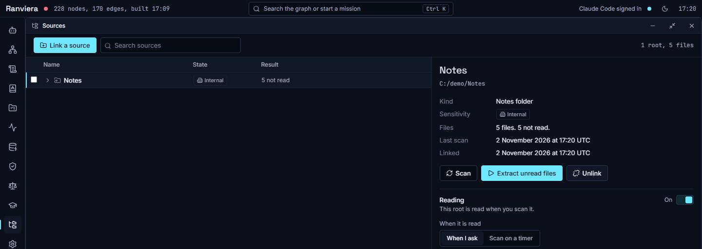
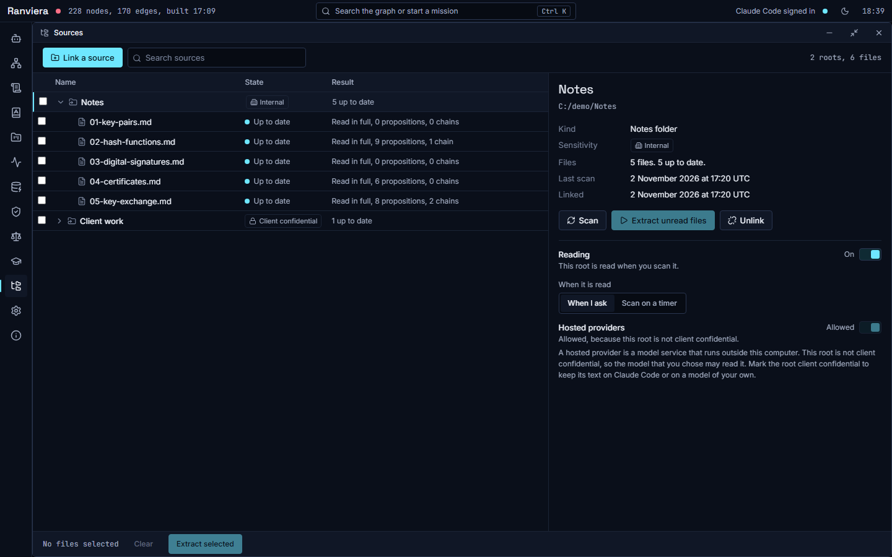
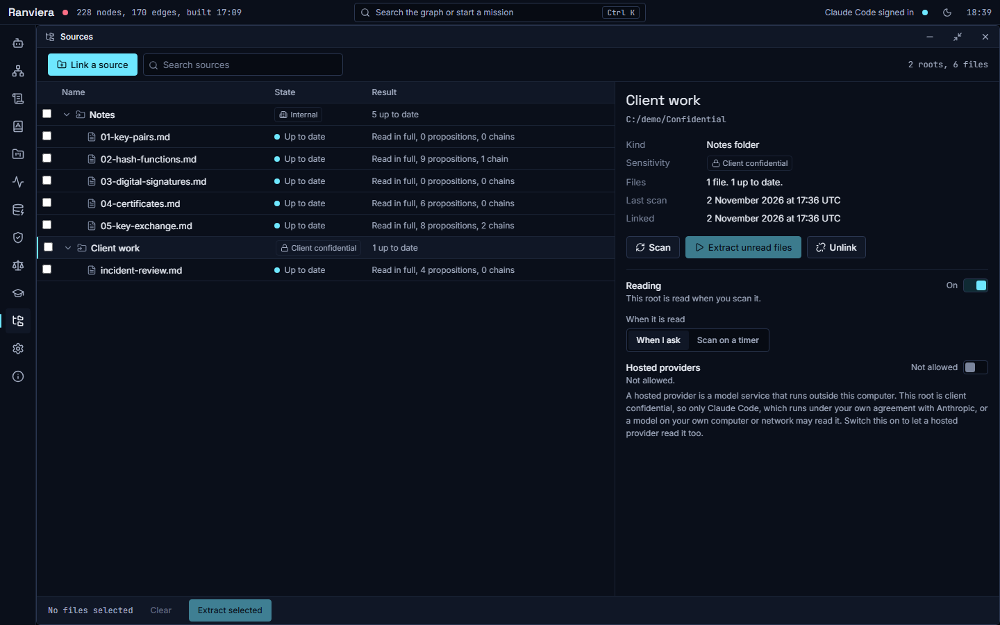
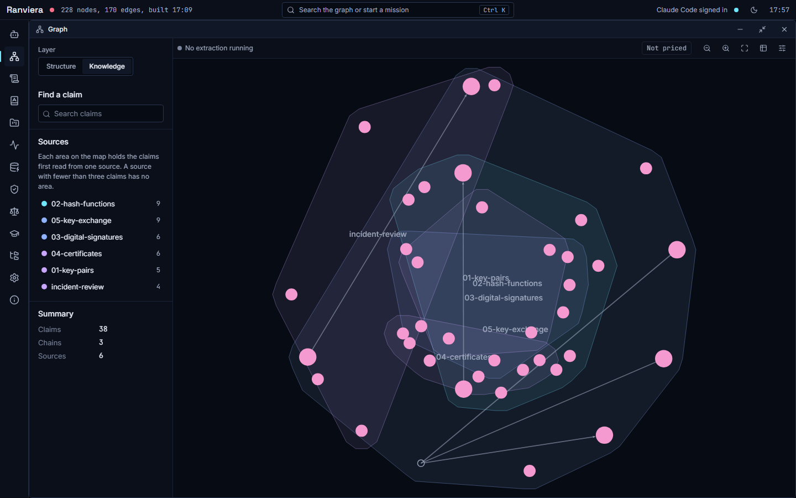
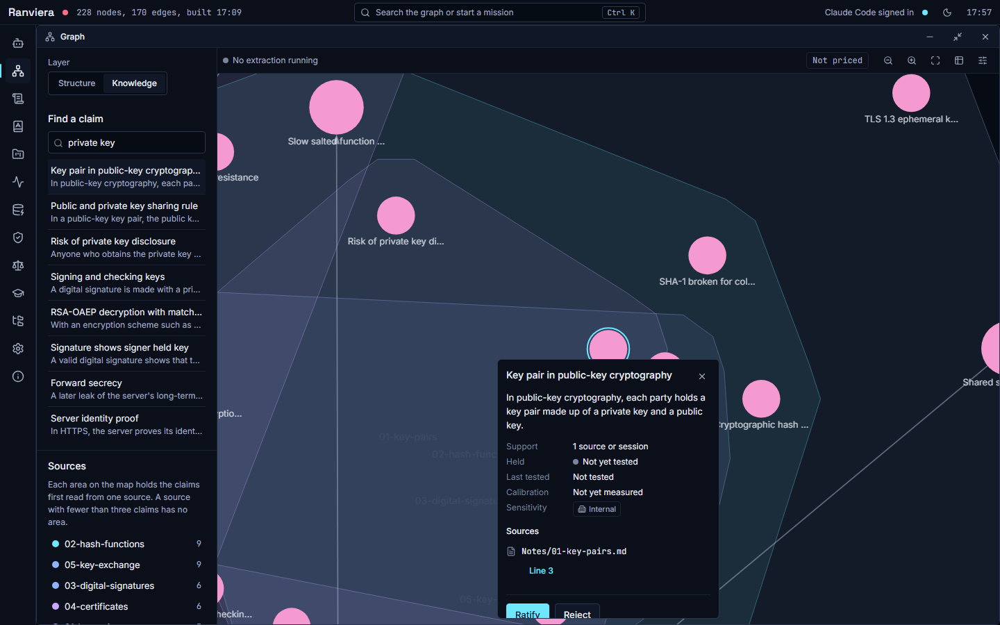
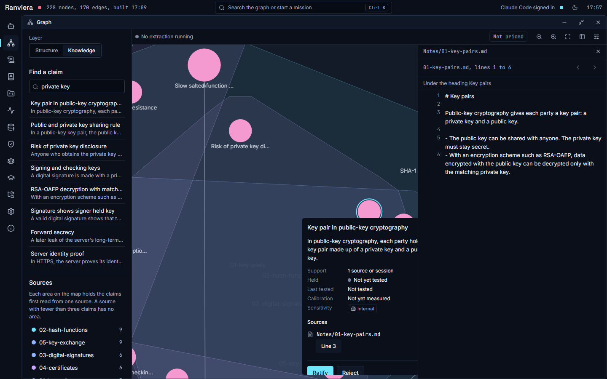

# Linked sources and the Knowledge layer

This guide shows how to link your own notes and files to Ranviera, read them into claims, and look at those claims in the Graph window. It covers the Sources window and the Knowledge layer of the Graph window.

## What a linked source is

A linked source is a folder or a file that Ranviera reads where it is. No file is copied, and the files are not changed. A linked folder or file is called a root.

Ranviera records a fingerprint of each file it has read, so that a later scan can see which files have changed. From the text of a file it extracts claims. A claim is one statement that the text makes, and it keeps a link back to the lines it came from.

## Kinds of source

The Kind list in the Link a source form offers seven kinds. Each kind reads a usual set of files, and you can change that set with include and exclude patterns.

| Kind | What it reads | Default sensitivity |
|---|---|---|
| Notes folder | Markdown and text files. It skips .obsidian, .git, node_modules and .trash. | Internal |
| PDF file | One PDF file. Choose the PDF file and not a folder. | Internal |
| Claude memory | The Markdown files in the memory folder of a Claude project. It skips MEMORY.md. | Client confidential |
| Claude transcripts | The .jsonl transcript files of Claude Code sessions in one folder. | Client confidential |
| Claude instructions | CLAUDE.md, the rule files and the SKILL.md file of each skill. It skips skills/synced. | Internal |
| Project documents | The Markdown files of a projects folder. It skips node_modules, archive, _work and .git. | Client confidential |
| LearnHarness folder | The data folder of a LearnHarness installation. | Internal |

Ranviera is not affiliated with LearnHarness. It can read this folder because the two programs share a data format.

## Sensitivity labels

Each root has a sensitivity label. The label decides which models may read the text of its files. Each claim takes the highest label of the sources it came from.

A hosted provider is a model service that runs outside your computer. The three labels allow the following:

- Public is for text that may be shared. It is the lowest label. The model that you chose may read it, wherever that model runs.
- Internal is for text that is for you or your team. It is the default for notes, PDF files, Claude instructions and LearnHarness folders. The model that you chose may also read it, wherever that model runs. Choose Client confidential for any text that must not reach a hosted provider without your consent.
- Client confidential is for text that belongs to someone else or must not leave your control. Only Claude Code, which runs under your own agreement with Anthropic, or a model on your own computer or network may read it. A hosted provider may read it only after you switch on Hosted providers for that root.

Choose the label with care when you link a root, because it applies to all the text that Ranviera reads from the root.

## Link a source

1. Open the Sources window by selecting Sources in the dock. This window has no keyboard shortcut.
2. Select Link a source.
3. In Kind, choose one of the kinds above.
4. In Path, type the folder, or the file for a PDF. A hint under the box says what to enter for the kind you chose.
5. In Label, type the name to show in the tree. If you leave it empty, Ranviera uses the folder name.
6. In Sensitivity, choose Public, Internal or Client confidential.
7. Under Reading in the form, choose When I ask or Scan on a timer. When I ask means files are read only when you start a scan. Scan on a timer means Ranviera scans the root again at regular intervals and may also start extraction of new or changed files without a click, which uses tokens at a hosted provider.
8. To change which files are read, type one pattern on each line in Include patterns or Exclude patterns, for example drafts/**. If Include patterns is empty, Ranviera uses the usual files of the kind.
9. Select Link source.

If the link fails, a red message under the form gives the reason. You can correct the form and try again.

## Scan and extract

A scan lists the files of a root and notes which ones are new or changed. A scan does not turn the text into claims. Extraction does that.

1. Open the Sources window by selecting Sources in the dock, then select the root in the tree.
2. Select Scan. Files that have not been read are shown as Not read yet, and the root shows a count such as 5 not read.
3. Select Extract unread files. The files are queued, and the window says how many were accepted, how many started and how many are waiting.

When extraction finishes, each file shows a result such as Read in full or Partly read, with the number of propositions and chains it produced. A proposition is a claim in the graph, and a chain links claims that follow from one another. The root then shows a count such as 5 up to date.

You can also extract only some files. Tick the files in the tree, and the button changes to Extract with the number of files. To read one file, select it and choose Extract, or Extract again if it was read before.

Some files are refused, and the Result column says why. For example, the file type may not be supported, or the file may be larger than 25 MiB. A Client confidential root is also refused if the chosen model is hosted and you have not allowed hosted providers.

### Confirmation before a large extraction

If you select Extract unread files and more files wait to be read than one scan may take (50 unless you change it in Settings), Ranviera asks you to confirm before it starts. A message gives the number of files and an estimate of the tokens of text to be read. Tokens are the units in which models count text, and they set the cost at a hosted provider.

1. Read the message, which begins This will read and ends Confirm to start the extraction.
2. Select Confirm and extract to start, or Cancel to stop.

## The Hosted providers switch

Select a root to see its Reading and permission section. A hosted provider is a model service that runs outside your computer. The Hosted providers switch decides whether a hosted provider may read the text of the root.

- For a root marked Public or Internal, the model that you chose may read it, wherever it runs. The switch shows Allowed and cannot be changed. The line says "Allowed, because this root is not client confidential."
- For a root marked Client confidential, only Claude Code or a model on your own computer or network may read it. Claude Code runs under your own agreement with Anthropic.
- A hosted provider may read a Client confidential root only after you switch on Hosted providers for that root. The label of the switch is "Allow hosted providers to read" followed by the name of the root. Ranviera records the date, and the line then says "Allowed since" with that date.
- Switching it off stops any further text from the root going to a hosted provider.

To allow a hosted provider to read a Client confidential root, follow these steps.

1. Open the Sources window and select the root.
2. In Reading and permission, switch on "Allow hosted providers to read" for that root.
3. Check that the line shows "Allowed since" and the date.

If the switch is off and a hosted model is chosen for a Client confidential root, the server refuses the request before any model call. The refusal says: "This material is client-confidential and the chosen model is hosted. Choose Claude Code or a local model, or record consent for the source in Sources."

The same section has a separate Reading switch, which is different from the Reading choice in the Link a source form. When the switch is Off, the root keeps its claims but is not scanned or extracted. Below it, a When it is read choice shows the form choice again (When I ask or Scan on a timer) and lets you change it.

## Unlink a source

Unlinking stops Ranviera tracking the root. The files on disk do not change.

1. Select the root, then select Unlink.
2. Choose what happens to the claims read from the root. Neither choice is ticked when the dialog opens.
   - Keep the knowledge leaves all the claims in the graph. No later scan will update them.
   - Delete the knowledge deletes the claims that rest only on these files, together with the record of what was read. A claim that another source also supports remains. This cannot be undone.
3. Read the effect that the dialog shows, then select Unlink.

## The Knowledge layer

The Graph window has 2 layers. Structure shows your Claude Code set-up. Knowledge shows the claims that you have extracted. Choose Knowledge in the Layer control to switch.

The Knowledge layer draws each claim as a node. Claims are grouped in an area for each source, and a source needs at least 3 claims to have an area. A side panel holds the list of sources and a count of claims, chains and sources. The toolbar has zoom buttons, a chain table and render settings.

### Find a claim

1. Type in the Search claims box under Find a claim. The search looks at names, aliases and statements.
2. Select a result, or press Enter to take the first one. The map moves to the claim and opens its card.

### The card of a claim

The card shows the statement of the claim and the following details:

- Support, which is the number of sources and sessions that the claim came from.
- Held, which shows from your lessons whether you hold the claim. The values are Held, Shaky and Not yet tested.
- Last tested, which is the date of the last check, or Not tested.
- Calibration, which compares your confidence with your accuracy over your answers. The values are Calibrated, Overconfident and Underconfident, or Not yet measured.
- Sensitivity, which is the highest label of its sources.
- Sources, which lists each file or session that the claim came from.

### Open the source line

A source that is a file has a link such as Line 3, or Open file if no line is recorded. Select the link to open the passage.

The passage view shows the lines around the claim, at most 200 lines at a time, with the nearest heading above them. The Earlier lines and Later lines buttons move through the file. A note appears if the file changed after it was read.

### Ratify or reject a claim

A claim that a model extracted is not used in the checks of Ranviera until a person ratifies it.

1. Read the claim and its source line.
2. Select Ratify if the claim is right. The card says Ratified, and the graph is rebuilt.
3. Select Reject if the claim is wrong. Type the reason in the box, then select Reject claim. The card says Rejected, and the graph is rebuilt.
